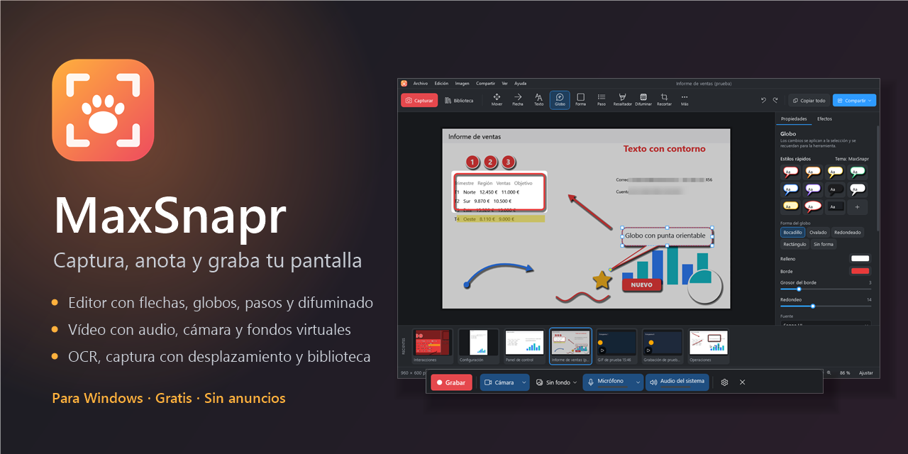
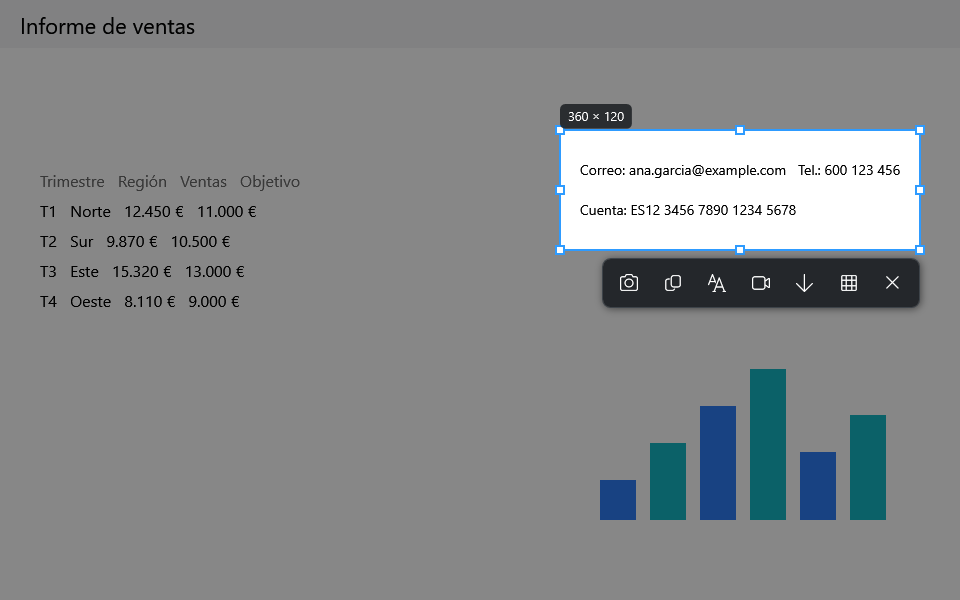
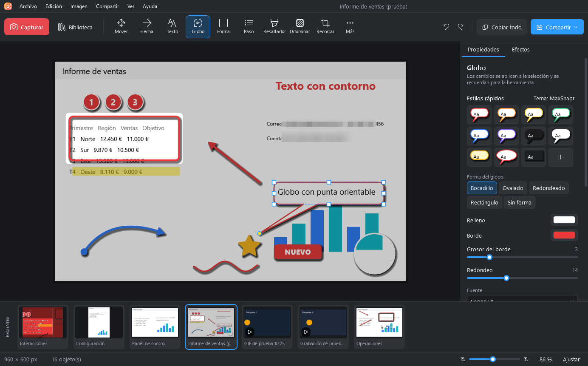
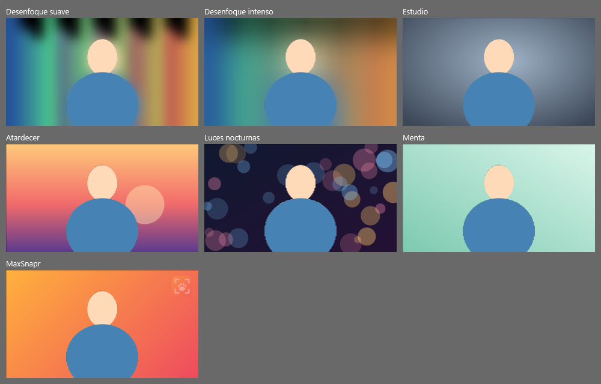
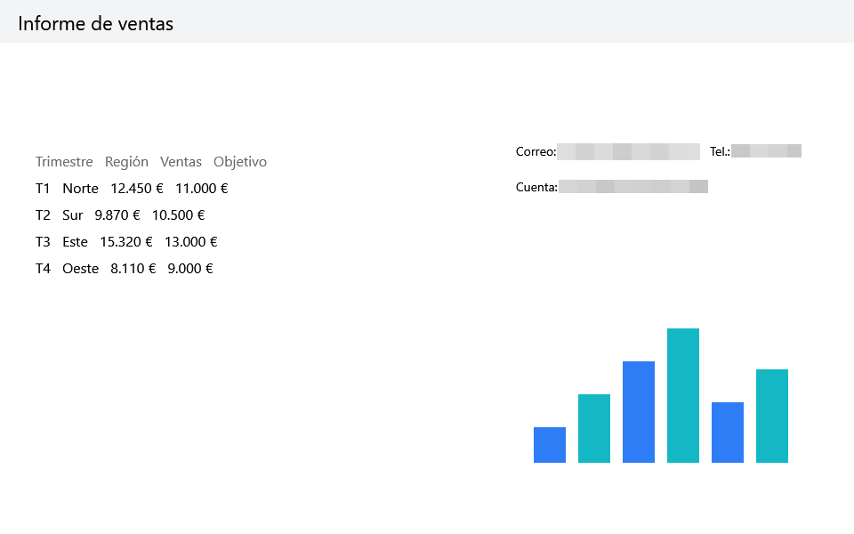
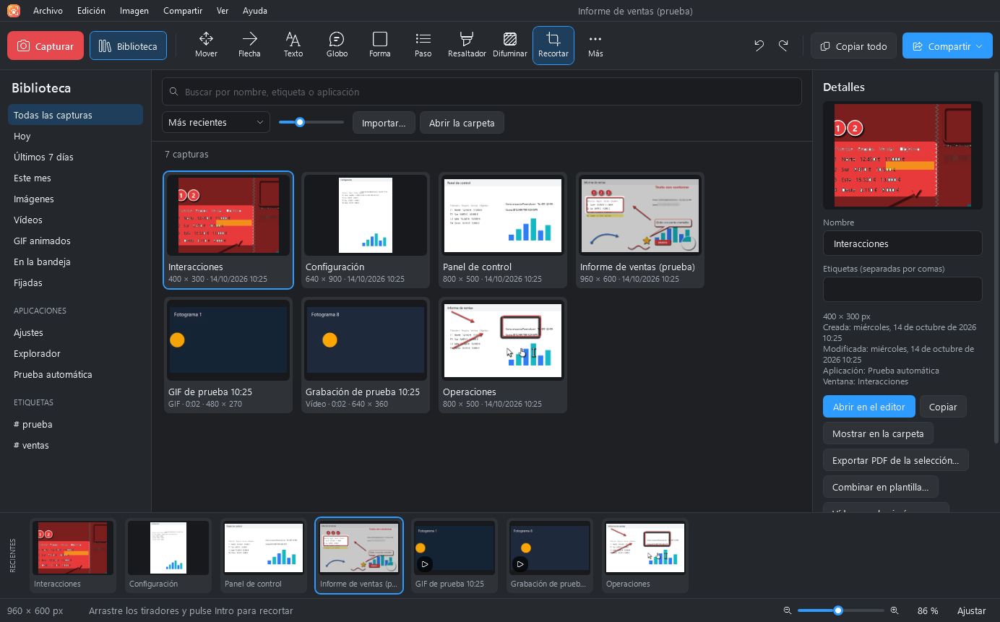

  

  <b>Captura, anota y graba tu pantalla en Windows.</b> 
  Gratis, sin anuncios y sin cuentas.

  <a href="../../releases/latest"><b>⬇️ Descargar MaxSnapr para Windows</b></a>

---

## ✨ Qué puedes hacer

**📸 Capturar lo que quieras.** Una zona, una ventana, la pantalla completa, un menú o una página larga con desplazamiento. Pulsa `Impr Pant`, elige y listo.

**✏️ Explicarlo con flechas, globos y pasos.** Resalta, difumina, amplía con lupa, numera pasos y añade texto. Todo sigue siendo editable después.

**🎥 Grabar vídeo con tu voz y tu cámara.** Con el sonido del equipo y el micrófono. Coloca la cámara donde quieras arrastrándola, cambia su tamaño y ponle un fondo desenfocado o una imagen. Después recorta, quita tramos o conviértelo en GIF.

**🔒 Ocultar datos privados en un clic.** Correos, teléfonos, cuentas bancarias, tarjetas o caras se detectan y se difuminan solos.

**🔍 Copiar el texto de cualquier imagen**, aunque sea una foto o un vídeo pausado.

**📚 Encontrarlo todo después.** Cada captura y grabación se guarda sola en tu biblioteca, con búsqueda incluso por el texto que aparece en las imágenes.

Y mucho más: captura de pasos para crear guías, plantillas, efectos, captura programada, envío a Word, PowerPoint, Outlook, Teams o Slack, y recibir fotos desde el móvil.

---

## ⬇️ Instalar en un minuto

1. Entra en la [última versión](../../releases/latest) y descarga **`MaxSnapr-Setup-X.Y.Z.exe`**.
2. Ábrelo y pulsa **Siguiente** hasta terminar. No pide permisos de administrador.
3. ¡Listo! MaxSnapr aparece en el menú Inicio y junto al reloj, en el área de notificación.

> **¿Windows muestra «Windows protegió su PC»?** Es normal en aplicaciones nuevas que todavía no están firmadas digitalmente. Pulsa **Más información** y luego **Ejecutar de todas formas**.

**¿Prefieres no instalar nada?** Descarga **`MaxSnapr-X.Y.Z-portable.exe`** y ábrelo directamente.

Funciona en **Windows 10 (versión 2004 o posterior) y Windows 11** de 64 bits. No necesitas instalar nada más.

---

## ⌨️ Atajos principales

| Para… | Pulsa |
|---|---|
| Capturar | `Impr Pant` (o `Ctrl+Mayús+C`) |
| Grabar vídeo | `Ctrl+Mayús+V` |
| Copiar el texto de la pantalla | `Ctrl+Mayús+T` |
| Repetir la última captura | `Ctrl+Mayús+R` |
| Crear una guía paso a paso | `Ctrl+Mayús+P` |
| Ver todos los atajos (en el editor) | `F1` |

Al capturar: **arrastra** para elegir una zona, **haz clic** en una ventana o pulsa **Intro** para la pantalla completa. Todos los atajos se pueden cambiar en *Preferencias*.

---

## ❓ Preguntas frecuentes

**¿Es gratis?**
Sí, para uso personal y profesional, sin anuncios ni límites.

**¿Envía mis capturas o datos a algún sitio?**
No. No tiene cuentas, publicidad ni telemetría. Todo se queda en tu equipo, y solo se comparte lo que tú decidas compartir. Lo único que hace por su cuenta es comprobar una vez al día, de forma anónima, si hay una versión nueva; puedes desactivarlo en *Preferencias*.

**¿Dónde se guardan mis capturas?**
En `Documentos\MaxSnapr\Biblioteca`. En *Preferencias › Biblioteca* puedes cambiar la carpeta y hacer o restaurar copias de seguridad.

**¿Cómo actualizo?**
MaxSnapr te avisa al arrancar cuando hay una versión nueva, con sus novedades. Pulsa **Descargar e instalar** y se actualiza solo, conservando tus ajustes y capturas. También puedes comprobarlo en *Ayuda › Buscar actualizaciones* o descargar el instalador de la última versión e instalarlo encima.

**¿Cómo la desinstalo?**
Desde *Configuración › Aplicaciones › MaxSnapr › Desinstalar*. Tus capturas y grabaciones no se borran.

**¿Cómo sé que el archivo es el original?**
Cada versión incluye `SHA256SUMS.txt` con la huella de cada archivo. En PowerShell puedes calcular la del tuyo con `Get-FileHash .\MaxSnapr-Setup-X.Y.Z.exe` y compararlas.

**¿No funciona `Impr Pant`?**
Puede que Windows lo use para la Herramienta Recortes. MaxSnapr usa entonces `Ctrl+Mayús+C`. También puedes desactivarlo en *Configuración › Accesibilidad › Teclado*.

---

  Hecho con 🐾 en honor a <b>Max</b>. 
  © 2026 danfigi. Uso gratuito según la <a href="LICENCIA.txt">licencia de uso</a>. Créditos de componentes de terceros en <a href="docs/TERCEROS.md">TERCEROS.md</a>.

